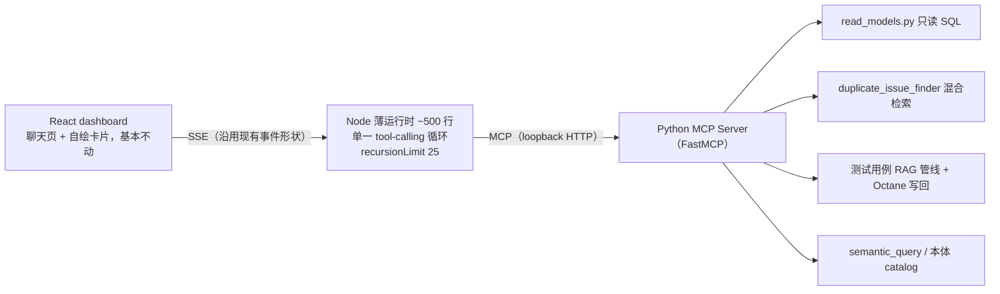

# 智能问数 Agent 架构简化方案（LibreChat 化）— 2026-10-21

## 1. 结论（TL;DR）

**不建议整体引入 LibreChat 产品，建议"借它的设计"：把自研 harness 里的规划、路由、答案治理层整体删除，把数据能力收敛为一组 MCP 工具，让模型在一个标准 tool-calling 循环（步数上限 25，而非现在的 4）里自主完成问数。**

核心口诀：

> 规划交给模型，能力收敛成工具，治理收缩到工具边界（鉴权 + 行级 scope + 只读），答案不再被代码审查后"释放"。

两条路线共用同一个第一步（数据面 MCP 化），所以先做 MCP 化无论如何不亏：

- **方案 B（推荐）**：保留现有 React dashboard 和自绘结果卡片，用薄 tool-calling 循环替换 18.9K 行 server harness 的 L1 层。**2026-10-21 补充：该薄循环建议直接引用 pi（`@earendil-works/pi-agent-core` + `pi-ai`）实现而非手写，MCP 化可后置为可选，见第 9 节。**
- **方案 A（备选）**：直接部署 LibreChat 产品作为独立聊天门户，数据面走 MCP 接入。被三个硬伤卡住：自绘卡片无扩展点（只能 fork 客户端，上游迭代快、维护税高）、部署形态（Docker + Mongo + pgvector vs 现在的 Windows 本地 SQLite 零依赖）、聊天是内嵌在 dashboard 里的一页而非独立应用。

## 2. 现状诊断：复杂度都在哪、为什么压制了泛化

server/ 合计 **18,851 行**（根 14,150 + agentRuntime 2,231 + ontology 2,470），其中约 **49% 是通用 agent 管道**，且存在大量重复：

| 问题 | 证据 |
| --- | --- |
| intent→工具映射存了 **三份** | `mainAgentToolRegistry.mjs`（253 行）、`mainAgentIntentRouter.mjs`（118 行，regex 逐字重复）、`mainAgentToolsets.mjs`（31 行） |
| 存在 **两个并行 agent 循环** | `agentRuntime/langGraphChatRuntime.mjs`（1,311 行）与 `mainAgentToolOrchestrator.mjs`（325 行） |
| 规划是 **四级优先级瀑布，LLM 排最后** | `langGraphChatRuntime` 的 plan_tool_calls 依次尝试：① 硬编码"缺陷报告人"确定性工具调用（`mainAgentToolPlanning.mjs:198-367`）→ ② 指纹校验的受治理语义计划 → ③ 确定性 R0 规范查询计划 → ④ 才轮到 LLM 自主规划 |
| 步数上限 **4**（clamp 1–10） | `langGraphChatRuntime.mjs:1151`；LibreChat 默认 recursionLimit 是 **25**、上限 50+ |
| 答案被代码审查后才"释放" | `answerValidator.mjs`（321 行引文/因果/数值核对）+ `answerGuardrails.mjs`（268 行）+ `companyChat.mjs` 的缓冲释放门：校验不过，流式答案整体替换成 canned 拒绝话术 |
| 语义工具只能跑在指纹计划里 | `inspectReadySemanticPlan` 8 种 `GOVERNED_QUERY_PLAN_*` 拦截码 |
| 24 个工具、三层注册表 + 一个 2,462 行大文件分发 | `mainAgentTools.mjs`：schema 数组 + 60 个 executor + if/else 分发器 |

**对"自主性和泛化"的实际伤害**：模型第 4 优先级才被允许自己规划；即使被允许，也只有 4 步预算；空结果由代码兜底重试（`diagnose_analytics_empty` + alias 重试）而不是让模型自己反思换条件；追问被做成 `ask_clarification` 工具；最终答案随时可能被释放门替换。这不是一个 agent，是一个被确定性管道包住的问答系统——复杂度正比于"防御模型犯错"的层数。

**真正有价值的部分（要保住的）**：

- 数据面：`backend/analytics/read_models.py` 手写 SQL 只读查询（**没有 LLM 生成 SQL，这是对的，保持**）、`duplicate_issue_finder.py`（dense+sparse+RRF+rerank+反馈学习的混合检索）、测试用例 RAG 管线、两个 JSON-lines bridge。
- 前端：`DuplicateSearchResults` / `TestCasePreviewCard` / `AnalysisResultChart` 三个自绘结果卡片 + SSE 流式渲染（`<step>`/`<cite>` 标记协议），这是 LibreChat 给不了的差异化 UX。
- 鉴权与行级 scope：OIDC（`agentAuth.mjs`）+ actor capability + FastAPI 侧行策略，这是安全底线，保留。

## 3. LibreChat 的设计要点（借什么）

LibreChat v0.8.8（2026-09，MIT）的 agent 层就是"一个标准循环 + 声明式工具"，没有一行 intent 路由或确定性规划：

| LibreChat 机制 | 做法 | 对应到本仓库 |
| --- | --- | --- |
| 循环 | `@librechat/agents`（LangGraph 系）单 agent tool-calling 循环，`recursionLimit` 默认 25，超限保留部分回答并给"继续/现在作答"选项 | 删除四级规划瀑布和第二个并行循环，换成 ~100 行核心循环 |
| 工具 | 一份声明式定义（OpenAI function schema / MCP），Agent Builder 里按 agent 勾选 | 三份 intent 注册表全删；工具在 MCP server 里只定义一次 |
| 扩展 | 官方 2026 推荐 **MCP**（in-repo plugin 已标记 deprecated）；`mcpServers` 支持 streamable-http、per-user header/OBO、OAuth2+PKCE | 数据面 MCP 化 = 同时服务自研 runtime 和未来任何 MCP 客户端 |
| 治理 | **工具级**而非答案级：`toolApproval` 的 allow/deny/ask 规则（如 `mcp:<server>:<tool>`）、MCP 地址白名单 | 把治理收缩到工具边界：OIDC + 行级 scope + 只读；删掉答案释放门 |
| 无预路由 | 没有意图分类器，模型看工具描述自己选；配套 `ToolSearch` 让工具多时可被运行时发现 | 删 16 个 intent profile 和正则路由；把 catalog/字段/术语做成工具让模型自己查 |
| 审计 | 运行日志/步骤流，没有证据契约 | 简化为 `tool-calls.jsonl` + run summary，删 qualification/依赖边界门 |
| 追问 | 模型直接用自然语言问用户（Ask-User 是给沙箱场景的） | 删 `ask_clarification` 工具 |

LibreChat 的 RAG API 是面向用户上传文件的（pgvector），不适合我们的 SQLite 语料，不引入。Code Interpreter 沙箱无网络，数据访问仍须走工具，对本方案无增益，暂不引入。

## 4. 目标架构（方案 B，推荐）



### 4.1 L0 数据面：一个 MCP server，工具从 24 收敛到 9

| 新 MCP 工具 | 吸收的旧工具 | 说明 |
| --- | --- | --- |
| `get_data_catalog` | get_data_catalog、get_ontology_catalog、search_octane_fields、resolve_business_terms、search_analytics_filter_values | 一个 catalog 工具，`focus` 参数选 metrics/filters/fields/terms。模型的"规划能力"来自这里——给它好的 schema 描述，而不是代码替它规划 |
| `query_defects` | query_analytics、query_defect_aggregate、query_analytics_fallback、query_defect_records、**diagnose_analytics_empty（删）** | 一个工具四种 intent（aggregate/trend/rank/records）。空结果时模型自己查 catalog 换过滤值重查——这正是自主性 |
| `query_coverage` | 3 个 coverage 工具 | 合并 |
| `query_traceability` | query_traceability | 保留 |
| `query_dashboard_summary` | query_dashboard_summary、query_full_picture_module | 合并 |
| `search_duplicates` | search_duplicates | 保留（Python bridge） |
| `get_testcase_context` | get_test_case_context | 保留 |
| `create_testcase` | create_testcase | preview/commit 两阶段合一 |
| （删除） | ask_clarification | 模型直接用自然语言追问 |

治理全部下沉到 MCP 工具内部（LibreChat 式"工具边界治理"）：

- **鉴权**：Node 层沿用现有 OIDC/internal 鉴权；MCP server 只监听 loopback，actor scope 由 Node 注入（沿用 capability HMAC 或进程间信任）。
- **行级 scope**：FastAPI 侧 scope policy 保留，在工具执行处过滤。
- **只读**：继续手写 SQL read models，**不引入 LLM 生成 SQL**；唯一写操作是 `create_testcase` 的显式 commit。
- **超时/行数上限**：工具内部实现，替代外层 recovery/circuit breaker。

### 4.2 L1 运行时：薄循环（可不再依赖 LangGraph）

LibreChat 的循环本质就是"模型要工具 → 执行 → 结果回填 → 循环，直到模型给终答或步数用尽"。核心约 100 行：

```js
// server/agentRuntime/toolLoop.mjs（示意）
export async function runAgentTurn({ messages, tools, callTool, streamAnswer, limit = 25 }) {
  const convo = [...messages];
  for (let step = 0; step < limit; step++) {
    const res = await requestToolCompletion(convo, tools);   // tool_choice: "auto"，无预路由
    const msg = res.choices[0].message;
    if (!msg.tool_calls?.length) {
      await streamAnswer(msg.content);                       // 终答直出，无释放门
      return { status: 'completed', steps: step };
    }
    convo.push(msg);
    for (const call of msg.tool_calls) {                     // 工具失败=把错误文本回给模型，让它自己决定重试/换路
      const out = await callTool(call);                      // → MCP callTool
      convo.push({ role: 'tool', tool_call_id: call.id, content: out.content });
      emitToolStep(call, out);                               // SSE: tool-input/output-available（沿用现有事件）
    }
  }
  return { status: 'max_steps', steps: limit };              // 超限保留部分结果，提示"继续"
}
```

- MCP 客户端用官方 `@modelcontextprotocol/sdk`，工具 schema 从 MCP server 自动获得，Node 侧**零工具定义代码**。
- 检查点/会话恢复：v1 不做（当前 SqliteSaver 检查点没有面向用户的恢复入口）；确有需要再加 LangGraph checkpointer，循环结构不变。
- 失败处理哲学变更：工具报错不再是代码分类重试（`mainAgentToolRecovery` 的 deny/catalog/retry/diagnose/stop 五分类），而是**把错误作为 tool 消息还给模型**。这是"保留自主"的关键一条。

### 4.3 L2 前端：基本不动

- SSE 事件形状保持兼容：`tool-input/output-available` → 现有 StepBlock；`context` → DuplicateSearchResults 卡片；`analysis-result` → AnalysisResultChart（已按 `visualization` profile 而非工具名渲染，天然兼容工具合并）。
- `<cite source=>` 标记协议保留，但改为 **prompt 契约**（系统提示要求引用工具调用 id），不再是硬校验门；CitationChips 继续工作。

### 4.4 删除清单（Phase 3 一次性删）

`mainAgentToolRegistry / mainAgentIntentRouter / mainAgentToolsets / mainAgentPolicyGate / mainAgentToolLoop / mainAgentToolOrchestrator / mainAgentToolPlanning / mainAgentToolRecovery / mainAgentDirectIntent / mainAgentEvidence / answerValidator / answerGuardrails / agentQualification / nodeDependencyBoundary / unifiedDataAgentSystem`，`langGraphChatRuntime` 的规划/校验节点，`ontology/` 只保留 catalog 数据产出（删 queryPlanner/analysisPlanner/fingerprint 门）。

预计 server/ 从 ~18.9K 行降到 **~6–7K 行**（保留：鉴权、bridge、duplicate/testcase 域逻辑、媒体处理、SSE 传输、轻审计）。

## 5. 方案 A：直接上 LibreChat 产品（何时选、怎么接）

**选择条件**：想要一个独立的多用户 AI 门户（而非内嵌 dashboard 的聊天页）、能接受 Docker + Mongo + Meilisearch + pgvector 的部署形态、不需要在聊天流里渲染自定义结果卡片。

接入方式（Phase 1 完成后只需配置，零代码改动）：

```yaml
# librechat.yaml（节选）
endpoints:
  custom:
    - name: 公司模型
      apiKey: ${COMPANY_API_KEY}
      baseURL: https://公司网关/v1      # ACCESSCODE 类鉴权需要一层小代理（现有 GLM proxy 模式可复用）
      models: [deepseek-v4-pro, deepseek-v4-flash, qwen3.7-max, qwen3.7-flash, glm-5.1]
mcpServers:
  vizion-data:
    type: streamable-http                # stdio 仅限本地单用户，远程必须 streamable-http
    url: http://内网主机:9100/mcp
    headers:
      X-Actor-Id: '{{LIBRECHAT_USER_ID}}'
```

得到的额外能力：Agent Builder（按 agent 配模型/指令/工具勾选）、`toolApproval` 审批规则、subagents、OIDC 一等公民、中文 UI。

**代价**：自绘卡片只能在 markdown/表格/Artifacts 里降级表达；fork 客户端则背上上游快速迭代（v0.8.8 六周 4 个 RC）的维护税；Windows 本地零依赖形态消失。

## 6. 迁移路径（可回滚，四阶段）

| 阶段 | 内容 | 验收 |
| --- | --- | --- |
| **P0 冻结** | 旧 harness 只修 bug 不加功能 | — |
| **P1 MCP 化**（1–2 周） | 新建 `backend/mcp_server/`（FastMCP，streamable-http，loopback）：包装现有 FastAPI read models、duplicate bridge、testcase bridge，实现 9 工具 + 行级 scope + 超时。数据逻辑零改动 | 用 MCP inspector 手动调通全部工具；现有 Python 测试不回归 |
| **P2 薄运行时**（1 周） | 新增 `server/agentRuntime/toolLoop.mjs` + MCP client，挂 `VIZION_AGENT_RUNTIME=simple` 特性开关；SSE 事件对齐现有前端 | dashboard 聊天页在新 runtime 下完成主流程（问数/重复检索/测试用例预览） |
| **P3 切换与删除**（1 周） | 用 `evals/scorecard` + agent fixtures 跑新旧对比，重点加"泛化用例"（intent profile 覆盖之外的问题）；达标后默认 simple，删除第 4.4 节清单 | scorecard 不低于旧基线的核心问数指标，泛化用例显著变好；删除后 `npm test` 通过 |
| **P4（可选）** | LibreChat 产品试点，接入同一个 MCP server | 团队评估门户形态是否需要 |

## 7. 明示的取舍：丢掉了什么

这个方案是对近期"治理加固"方向（release-boundary hardening、evidence contract）的**主动回撤**，需要知情决策：

| 丢失 | 影响 | 缓解 |
| --- | --- | --- |
| 证据释放门（答案级校验） | 数值/引用幻觉风险回到模型层面 | prompt 契约强制 `<cite>`；CitationChips 已有；工具结果自带数值与行数；scorecard 加引文覆盖率指标回归 |
| 确定性恢复/alias 重试 | 空结果兜底从代码变成模型行为 | catalog 工具提供 filter 值 grounding；步数 25 给足重查空间；evals 观察 |
| 资质门/依赖边界/证据审计 | 发布流程变轻 | 保留 `npm test` + scorecard 作为发布门；审计简化为 tool-calls.jsonl |
| 受治理语义计划（指纹门） | ontology 从"可执行规划约束"降级为"描述性 catalog" | 业务规则（如 created-defect 必须带时间）改写进工具描述和系统提示，由模型遵守；高危 deny 规则可保留为工具入口处的硬检查（代码在工具里，不在循环里） |

安全底线不回撤：OIDC 鉴权、行级 scope、只读 SQL、`create_testcase` 显式 commit，全部保留（且 README 已注明 duplicate/legacy 路径本就未接行级 scope，P1 顺带补齐）。

## 8. 风险与开放问题

1. **公司模型 function-calling 可靠性**：deepseek-v4 / qwen3.7 / glm-5.1 的多轮工具调用质量决定薄循环体验。P2 期间用 fixtures 实测；不确定的工具调用可先保守设 `recursionLimit` 10–15。
2. **MCP server 常驻进程**：与现有 bridge 常驻模式等价，但 Windows 服务化需要部署脚本（现有 nightly task 脚本可扩展）。
3. **ontology 去留**：默认降级为 catalog 数据源。若团队仍要 `deny` 级硬规则，放进 MCP 工具入口检查（一行 if），不要放回循环层。
4. **前端 `context` 事件耦合**：`AIChat.tsx:794-805` 把 context 事件硬类型化为 DuplicateSearchResult，P2 保持该事件形状即可；后续再做类型收敛。

## 9. 补充调研：pi 最新版（2026-10-21）——L1 运行时改为直接引用 pi

### 9.1 pi 现状（2026-10）

- **已搬家**：2026-05 起 repo 由 `badlogic/pi-mono` 迁至 **earendil-works/pi**，npm scope `@mariozechner/*` → **`@earendil-works/*`**（旧包全部标记 deprecated）。现由 Earendil（公益公司）支持，badlogic 与 Armin Ronacher（mitsuhiko）共同维护；117k stars，MIT。
- **版本**：v1.0.0 于 2026-10-01 发布，最新 **1.3.0（2026-10-15）**，1.x 起遵循 semver。迭代极快（约 26 releases/月）。
- **分层**：
  - `pi-ai`：多 provider LLM 抽象——流式事件（text/toolcall delta）、**TypeBox** 工具 schema、结构化输出（json_schema/grammar）、成本统计。**自定义 OpenAI 兼容端点是一等公民**（`baseUrl` + `api:'openai-completions'`），直接匹配 DeepSeek/Qwen/GLM 公司端点。
  - `pi-agent-core`：**可嵌入的 `Agent` 类**——`agent.subscribe` 事件流（`turn_start/end`、`message_update`、`tool_execution_start/update/end`）、`beforeToolCall`/`afterToolCall` 拦截、`finishTurn` 控制循环终止、`steer`/`followUp`、`abort`、可序列化状态。这就是"通用 agent 循环"库，与编码无关。
  - `pi-mcp`：独立 MCP 客户端（stdio / Streamable HTTP / in-memory）——pi 已放弃早期"不需要 MCP"立场，1.0 起 MCP 内置。
  - `pi-coding-agent`：CLI + SDK，**编码专用**（AGENTS.md、文件工具、自动 compaction 都在这层，不通用）。
  - `pi-durable`：长任务运行时（实验性）。
- **pi-web-ui 已弃**：停在 0.75.3（2026-05），已移出仓库、不在 1.0 线内；且它是 Lit 组件（非 React）+ **浏览器内 Agent** 架构（API key 存 IndexedDB，无后端 SSE 协议），与我们的形态不匹配。其 `registerToolRenderer` 自定义工具卡片能力只存在于这个弃坑包里。

### 9.2 仓库内 "pi 语义内核" 与 pi 框架的关系

**无依赖关系。** `docs/integration/unified-integration-architecture.md` 里的 "L2 pi 语义内核" 是借 pi playbook 的治理思想（版本化本体 + SHA-256 指纹 fail-closed）自研的 2,470 行治理层，package.json 中没有任何 pi 包。注意它的方向（最大化治理）与本方案的简化方向相反，按第 4.4 节处理：降级为 catalog 数据源，删 planner/指纹门。

### 9.3 结论：可以引用，不能整体替换

- **引用（推荐，替代 4.2 节的手写循环）**：`pi-agent-core` 正是方案 B 那个薄循环的成熟替身。事件流与现有 SSE 一一对应（`message_update` → `choices[].delta`；`tool_execution_start/end` → `tool-input/output-available`）；`beforeToolCall` 承接 OIDC/行级 scope 的**工具级治理**（等价 LibreChat 的 toolApproval）；`finishTurn` 里自数 turn 即可设步数上限（agent-core 无内置 maxTurns）；工具定义成 TypeBox `AgentTool`，`execute()` 直调现有 FastAPI/bridge 执行器。

  ```js
  // 示意，API 以 1.3.0 的 .d.ts 为准
  import { Agent } from '@earendil-works/pi-agent-core';
  const agent = new Agent({
    initialState: { systemPrompt, model, tools },        // model = 公司 OpenAI 兼容端点
    streamFn: models.streamSimple.bind(models),
    finishTurn: () => (++turns >= 25 ? { action: 'end' } : { action: 'continue' }),
    beforeToolCall: (call, ctx) => assertActorScope(ctx, call),   // 工具级治理入口
  });
  agent.subscribe(ev => mapEventsToSse(ev, res));        // 事件 → 现有 SSE 形状，前端零改动
  await agent.prompt(userMessage);
  ```

- **整体替换（不可行）**：pi 不是可部署的聊天产品——CLI 是编码代理，pi-web-ui 已弃且架构不匹配（浏览器内 Agent、无 SSE 协议、非 React）。前端、门户形态仍按第 5 节结论，自绘卡片继续自持。
- **迁移路径修订**：第 6 节的 P1（MCP server）**后置为可选**——pi 路线下工具先在 Node 内用 `AgentTool` 包装现有执行器（最快路径，无额外进程/hop）；MCP server 只在想接 LibreChat 产品试点或跨客户端共享工具时再建（届时 `pi-mcp` 挂上即可，工具语义不变）。P0 / P2（特性开关并行）/ P3（scorecard 对比后删除旧层）不变。

### 9.4 pi 路线的风险

1. **迭代极快 + scope 刚改过名**：锁定精确版本（package.json 固定 1.3.x，不用 `^` 大跨度），升级走 `npm ci` + scorecard 回归门。
2. **1.0 仅三周**：生产先例集中在编码侧（OpenClaw 等）；非编码数据问答类案例少（pi-chat、sitegeist.ai 可参考）。MIT + 高质量 TS 类型降低风险，但属于"早采用"。
3. **杂项适配成本**：工具 schema 用 TypeBox 而非 zod（24→9 工具的 schema 改写是机械工作）；agent-core 无自动 compaction（沿用现有 `chatMessageBudget.mjs`）；无内置步数上限（`finishTurn` 自数，~10 行）。

